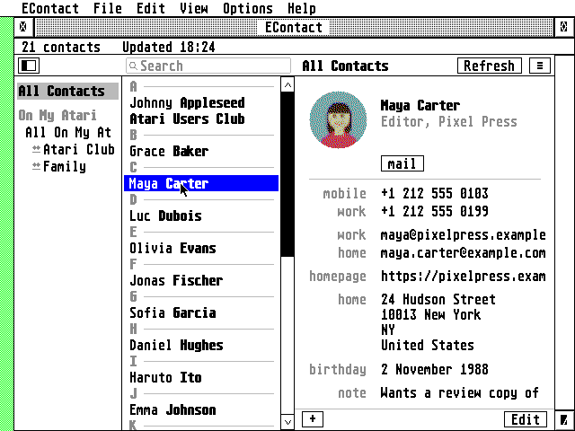

# EContact


An address book for the Atari ST, STE, TT and Falcon, written in C for GEM, that syncs with iCloud and
other CardDAV servers.

**Highlights**

- **Like the Mac's Contacts:** groups on the left, people under a search field, the chosen card on the right
- **iCloud and CardDAV** (Fastmail, Nextcloud, Radicale...), synced both ways
- **Contacts' photos**, from the card or iCloud's links, on any screen
- **Groups**, as iCloud keeps them and as Nextcloud does
- **The address book of [EMail](https://github.com/whomper/EMail) and [ECal](https://github.com/whomper/ECal):** pick people to write to and to invite
- **A desk accessory or a program**, with right-click menus, drag and drop and iconify
- **Several contacts at once:** Shift+click, Control+click, Select all
- **Secure:** TLS 1.2 on a Falcon or TT, the curves on the Falcon's DSP
- **Hebrew** names and notes right to left, the Israeli keyboard on F10
- **Works offline** from its own copy; vCard import and export



## Getting started

Download the latest **[release](https://github.com/whomper/EContact/releases/latest)** (each file, or all in `econtact-x.y.zip`).

| File | What it is |
|---|---|
| `econtact.acc` | the accessory, for every ST, STE, TT and Falcon |
| `econtact.prg` | the same, to start from the desktop, with a menu bar |
| `tls.ovl`, `cacert.pem`, `roots.dat` | a Direct connection on a TT or Falcon |
| `pic.ovl` | a Falcon's photos drawn with its DSP |
| `econtact.hyp`, `econtact.ref` | the guide, for the Help key |
| `econtact.rsc` and the rest | the desktop icon |

1. Copy `econtact.acc` to the root of your boot drive.
2. Put the other files in a folder of your choice; the first time it opens, EContact asks where it is.
3. On an ST or STE, set up the AERA Gateway (below).
4. Reboot, choose **EContact** in the Desk menu and add your account, with an
   [app password](docs/GUIDE.md#app-passwords-icloud-fastmail) for iCloud or Fastmail.

**Needs:** TOS 1.04 to 4.x, EmuTOS, MagiC or MiNT; ST high or medium, TT or Falcon resolution; 1 MB of
RAM or more; STinG or MiNTnet.

The whole setup (the Gateway's commands, updating, FOLDRxxx and STinG's settings) is in
[docs/SETUP.md](docs/SETUP.md); using it is in the [user guide](docs/GUIDE.md); how it works (photos,
memory, EMail and ECal) in [docs/DETAILS.md](docs/DETAILS.md).

## How it reaches the servers

Contacts servers want HTTPS. A Falcon or TT does it itself (a Direct connection, `tls.ovl`); an ST or STE
goes through the [AERA Gateway](https://github.com/whomper/AERA-Gateway#readme), a small service on a
Raspberry Pi at home that EContact shares with ECal and EMail: EContact sends it plain HTTP and the
Gateway talks HTTPS to the server. On a Falcon or TT the Gateway is optional, and an On My Atari
address book needs no server at all.

## Building

```sh
sudo apt install gcc-m68k-linux-gnu python3 zip
make          # binary/: econtact.acc, econtact.prg, roots.dat, tls.ovl, pic.ovl (and econtact.hyp with hcp)
make dist     # a release's files and zip in dist/
```

Releases, the help file and the icons: [docs/DEVELOPMENT.md](docs/DEVELOPMENT.md).

## Source

```
src/      the contacts core: vCard, CardDAV, accounts, caches, photos
ui/       the GEM program: window, list, card, editor, dialogs
common/   code shared with the other AERA programs
docs/     the user guide and the longer docs
```

The full list: [docs/DEVELOPMENT.md](docs/DEVELOPMENT.md#source).

## Tests

`make test` runs the core's tests; the rest (CardDAV, fuzzing, the Hatari rigs) is in [docs/DEVELOPMENT.md](docs/DEVELOPMENT.md#tests).

## Licence

GPL, version 2 or later: see [COPYING](COPYING). Copyright (C) 2026 AERA | Erez Yaary. It includes
[BearSSL](common/third_party/bearssl) (MIT), ChaN's [TJpgDec](third_party/tjpgd) and Mozilla's root
certificates (MPL 2.0), under their own licences.

---

Part of **AERA** for Atari: [ECal](https://github.com/whomper/ECal) · [EContact](https://github.com/whomper/EContact) · [EMail](https://github.com/whomper/EMail) · [EFTP](https://github.com/whomper/EFTP) · [EHypView](https://github.com/whomper/EHypView) · [ClaudeST](https://github.com/whomper/ClaudeST) · [EWeb](https://github.com/whomper/EWeb) · [EUpdate](https://github.com/whomper/EUpdate) · [EPDF](https://github.com/whomper/EPDF) · 8-bit: [EDOS](https://github.com/whomper/EDOS) · [EFTP_XL](https://github.com/whomper/EFTP_XL) · Gateway: [AERA-Gateway](https://github.com/whomper/AERA-Gateway)
