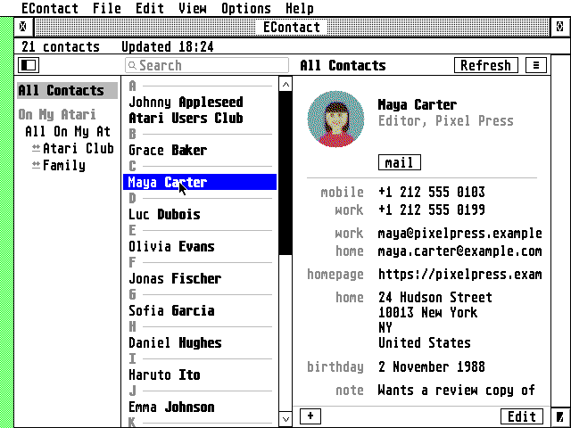
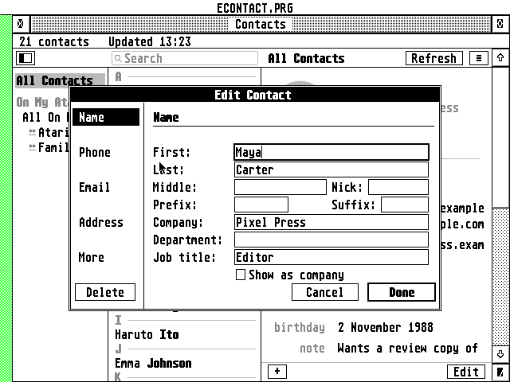
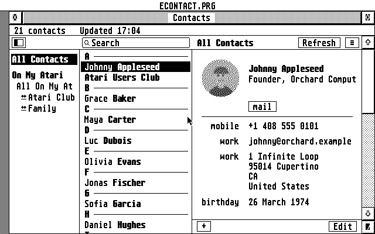
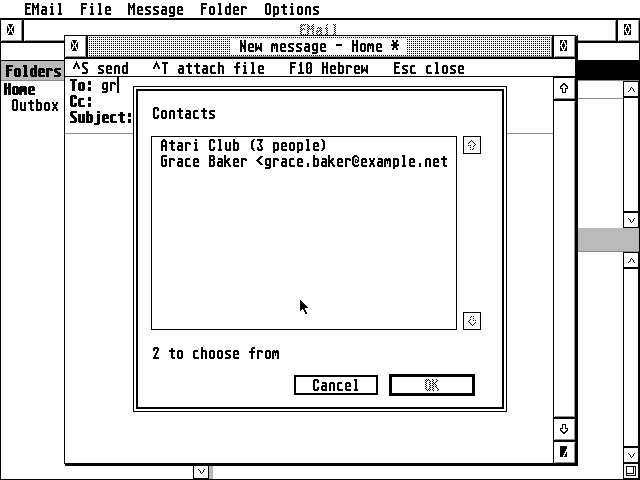
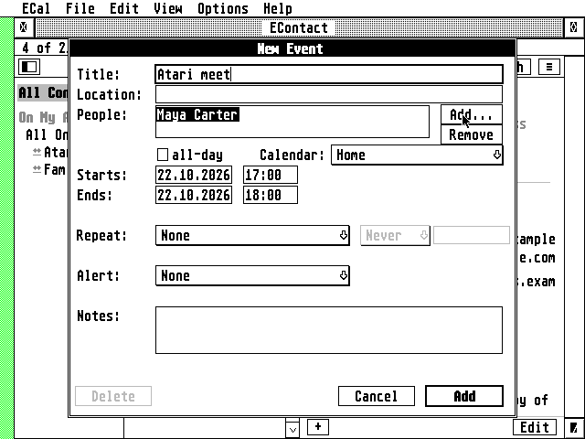

# EContact


An address book for the Atari ST, STE, TT and Falcon, written in C for GEM, that syncs with iCloud and
other CardDAV servers.

**Highlights**

- **Like the Mac's Contacts:** the groups on the left, the people in the middle under a search field,
  the chosen person's card on the right
- **iCloud and CardDAV:** iCloud and other CardDAV address books (Fastmail, Nextcloud, Radicale,
  Synology...), synced both ways; On My Atari address books too
- **Photos:** contacts' photos, from the card or from iCloud's links, dithered to whatever screen you
  have
- **Groups**, as iCloud keeps them (group cards) and as Nextcloud does (categories)
- **The address book of [EMail](https://github.com/whomper/EMail) and
  [ECal](https://github.com/whomper/ECal):** pick people to write to and to invite
- **Modern but Atari:** a desk accessory that opens from the Desk menu over whatever program you're
  in, or a program; right-click menus, .vcf files dropped on the window, iconify, Esc cancels any
  dialog, and the Help key opens the guide in EHypView or ST-Guide
- **Secure:** TLS 1.2 on the Falcon and TT, with RSA and the elliptic curves on the Falcon's DSP; the ST and STE through the AERA
  Raspberry Pi gateway, the one ECal uses
- **Hebrew** throughout: names and notes right to left, the Israeli keyboard (F10)
- **Works offline** from its own copy; vCard import and export



## Getting started

Download the latest release from
**[Releases](https://github.com/whomper/EContact/releases/latest)**: each file is there on its own,
and all of them together in `ECONTACT-x.y.zip`.

| File | What it is |
|---|---|
| `ECONTACT.ACC` | Falcon and TT: the accessory with Falcon mode (TLS, DSP); also works through the Pi |
| `ECONTST.ACC` | ST and STE: the same accessory without TLS (about 125 KB smaller), through the Pi |
| `ECONTACT.PRG` | the same as `ECONTACT.ACC`, to start from the desktop, with a menu bar |
| `CACERT.PEM`, `ROOTS.DAT` | the root certificates for Falcon mode |
| `ECONTACT.HYP` | the user guide for ST-Guide or EHypView: in EContact's folder, the Help key opens it |
| `ECONTACT.REF` | its pages' names, for ST-Guide's index (`ALL.REF`): goes with the .HYP |
| `ECONTACT.RSC`, `ECONTACT.DEF`, `ECONTACT.ICN`, `ECONTMSK.ICN` | the desktop icon (on their own, and in the zip's `icons/` folder): `ECONTACT.RSC` (black-and-white and 16-colour), `ECONTACT.DEF` (its names, for resource editors), `ECONTACT.ICN` and its mask `ECONTMSK.ICN` |
| `ECONTACT-x.y.zip` | all of the above |

**The desktop icon.** Copy the icons from `ECONTACT.RSC` into your desktop's icon file
(`DESKICON.RSC`, `DESKCICN.RSC`) with a resource editor; `ECONTACT.DEF` gives them their names there.
For EmuTOS, `tools/icon/add_to_emuicon.py emuicon.rsc EMUICON.RSC` writes a copy of EmuTOS's icon
file with EContact's added (it says which number), for the root of the boot drive; then
**Options > Install icon**. `tools/icon/make_rsc.py` makes the files from `tools/icon/make_icon.py`.

1. Copy `ECONTACT.ACC` (Falcon/TT) or `ECONTST.ACC` (ST/STE, renamed to `ECONTACT.ACC` or not) to
   the root of your boot drive (e.g. `C:\`): TOS loads accessories only from there.
2. Choose a folder for EContact, anywhere on any drive, and put the rest in it: `CACERT.PEM` and
   `ROOTS.DAT` for Falcon mode, `ECONTACT.HYP` and `ECONTACT.REF` for the Help key, and
   `ECONTACT.PRG` if you want the program. EContact keeps its address books there too. No folder
   has to exist beforehand, and none has a fixed name: the settings, `ECONTACT.INF` in the boot
   drive's root, say where it is in `FOLDER=`. Start `ECONTACT.PRG` from the folder once and it
   writes it there; or the first time you open the accessory it asks: **Locate...** (pick any file
   in the folder) or **Use C:** (the boot drive), which makes `C:\ECONTACT` for you.
3. For an ST or STE (or a Falcon or TT without Falcon mode), set up the gateway on a Raspberry Pi
   from [AERA-Gateway](https://github.com/whomper/AERA-Gateway)'s own copy, at its latest release
   (the copy in this repository is for EContact's tests). On the Pi:

   ```
   sudo apt install -y git                  (Raspberry Pi OS Lite only)
   git clone https://github.com/whomper/AERA-Gateway
   cd AERA-Gateway
   ./update-pi.sh
   sudo gateway/aera-gateway install dav --allow ATARI_IP
   ```

   Or the short way (AERA-Gateway 1.8 or later), every gateway in one line (EMail's too with
   `--mail IMAP SMTP`):

   ```
   sudo apt install -y git && git clone https://github.com/whomper/AERA-Gateway ~/AERA-Gateway &&
     ~/AERA-Gateway/update-pi.sh --allow ATARI_IP
   ```

   `ATARI_IP` is your Atari's address (`192.168.1.x`): the gateway answers it alone. ECal uses the
   same gateway: if it already works through your Pi, there is nothing to do.

   - To update: `cd ~/AERA-Gateway && ./update-pi.sh` (its settings are kept).
   - To check: `sudo aera-gateway status` (`gateway/aera-gateway status` in the folder).
   - In EContact: **Settings > Connection**, **Pi gateway:** the Pi's address (`PI_IP`),
     **Port:** 8180.
4. Reboot, choose **EContact** in the Desk menu, and add your iCloud account with an
   [app-specific password](https://support.apple.com/en-us/102654).
5. Press **Help** in EContact for the guide (with EHypView or ST-Guide installed as an accessory);
   the [user guide](docs/GUIDE.md) describes the rest.

**Updating:** copy the new release's files over the old ones (the accessory to the root, the rest
into EContact's folder) and reboot. The settings, the accounts and the copies of your address books
stay as they are.

**Needs:** TOS 1.04 to 4.x, EmuTOS, MagiC or MiNT; ST high, ST medium, TT or Falcon resolution; 1 MB
of RAM or more (a 512 KB ST can't run it: see [How many contacts](#how-many-contacts)), and TT/Fast RAM
is used where there is some; STinG or MiNTnet; on an ST or STE, the AERA Raspberry Pi gateway.

**Under TOS, put Atari's `FOLDR100.PRG` first in `AUTO`**, renamed for more room (`FOLDR400.PRG`).
TOS keeps an entry in a small internal pool for every folder a program or accessory has looked
into, and halts with "OUT OF INTERNAL MEMORY" when it runs out; FOLDRxxx makes the pool bigger.

**With STinG, set the Delay in `STING.CPX` to suit the machine:** 10 on a
Falcon or TT, 25 to 50 on an ST, as STinG's manual says. STinG looks at the network card that
often, so it sets the speed of every STinG program: on Erez's Falcon with a NetUSBee, Delay 10
took EFTP's downloads from 40 to 75 KB/s. On a NetUSBee, keep STinG's TCP receive window at 5840
(MSS 1460): the card holds about four full packets.

## How it reaches the servers

Contacts servers want HTTPS. EContact uses ECal's code and ECal's way:

```
ST, STE:     Atari (ECONTST.ACC) --plain HTTP, home LAN--> Raspberry Pi (ecalgate.py) --HTTPS--> the server
Falcon, TT:  Atari (ECONTACT.ACC, TLS 1.2, RSA and curves on the DSP) --------------------HTTPS--> the server
```

- **Through the Pi.** The AERA gateway's `dav` service (`ecalgate.py`) serves EContact as it serves
  ECal, and `ECONTACT.ACC` can use it too, on any Atari. If ECal already works through your Pi,
  type the same address and port in **Settings > Connection**.
- **Falcon mode.** TLS 1.2 on the Falcon or TT with BearSSL. On a Falcon the DSP56001 does the
  heavy sums: the server's RSA signature, and the elliptic curves of ECDSA certificates and of the
  key exchange (P-256, P-384, P-521, X25519), which take the 68030 tens of seconds. A signature
  once checked is remembered in `SIGS.DAT`, so the next start doesn't check it again (names, dates
  and the chain still are). A TT, which has no DSP, does it all on its 68030.

The gateway's own README: [gateway/README.md](gateway/README.md).

## What it does

Like ECal, EContact runs as a **desk accessory**, so it opens from the Desk menu over whatever program
you're in, and it is laid out like the Mac's Contacts: the groups on the left, the people in the middle
under a search field, the chosen person's card on the right.

- **The list**, sorted by last name under letter headings, the first name plain and the last name
  bold, the chosen one in a blue bar, as on the Mac. **Settings** sorts by first name or shows
  "Last, First".
- **The card**: the contact's photo in a circle (or the initials in grey when there is none), the
  name, the job and company, then every phone, email, web page and address with its label in grey
  ("mobile", "iPhone", "home", "work", "home fax", or your own), the birthday and the note. Click a
  value to copy it, or to write to an address in EMail; the **mail** button does the same.
- **Photos**: the JPEG in the card (as the Mac and iPhone write it) or behind a link (as iCloud often
  gives it), cropped as you cropped it on the iPhone, dithered to the screen's own colours on a Falcon
  or TT and to black and white on an ST. Syncing leaves them on the server: a photo is fetched when
  its card is opened, or all of them at once with **Sync Contact Photos...** (a progress bar, the time
  left, Cancel, and it goes on where it stopped; not in the accessory with under 1.5 MB free at start, a
  1 MB ST for one, whose memory is kept for the contacts: `ECONTACT.PRG` can). Decoded once (a second or two on a Falcon, about
  four on an 8 MHz ST, as measured in Hatari) and kept in `CACHE\PHOTOS.PAK`; a photo changed on the
  iPhone is noticed and decoded again (see [Photos and their cache](#photos-and-their-cache)).
- **Search** as you type: names, companies, emails, phone numbers (with or without spaces and
  dashes), addresses and notes.
- **Editing**: **+** and **Edit** at the bottom of the card, as on the Mac. The card's parts are
  sections of one dialog (Name, Phone, Email, Address, More) so it fits an ST's screen; labels come
  from a pop-up or **Custom...**. What EContact doesn't edit (the photo itself, related names, social
  profiles, Apple's own fields) is kept as it was.
- **Groups**: All Contacts, each account, its groups. **New Group...**, **Add to Group...**, Remove
  from the group, rename, delete; **Send Email to Group** gives EMail everyone in it. iCloud's group
  cards and Nextcloud's categories both work. A contact you make while a group is shown goes into it.
- **iCloud** and any **CardDAV** server: address books found automatically, changes made elsewhere
  fetched with ETags so only what changed comes over the line, saves checked with If-Match so a change
  made on the iPhone meanwhile isn't overwritten.
- **On My Atari** address books, kept only on this computer.
- **vCard files**: import (3.0, 4.0 and the 2.1 of old phones, with quoted-printable and any charset;
  written to the server as 3.0) and export, of one card, a group, a book or the search results.
- **My Card**, as on the Mac; the window opens on it.
- **Fonts** (the system font or any fixed-width GDOS font, in the family's Font dialog), the window and everything else are
  remembered in `ECONTACT.INF`, which explains itself.
- **Smooth on an ST**: the window is drawn off the screen and shown at once; the list scrolls by
  moving what is shown, and the scroll bar's arrows and track go on while held. Text fields hold
  more than they show (a long server address, a name) and scroll with the cursor.
- **A crash** in the program is caught: it says so, writes `CRASH.LOG` and quits, leaving the
  Atari running (the guide, When something goes wrong).

 

## EMail and ECal

EContact is the address book of the other two:

- **EMail**: the addresses it shows carry EContact's names, and its **Address book...** (^B) picks
  people or a group in EContact's window (Choose or Cancel in the toolbar). EContact's **mail**
  button, or a double-click on an address, opens a new message to that person in EMail.
- **ECal**: an event has **People**; **Add...** picks people or a whole group from EContact (or takes
  an address). iCloud and other CalDAV servers that do scheduling (RFC 6638) send the invitations by
  email. An invitation from someone else shows who sent it. ECal's **Contacts...** in its menu
  opens EContact's window.

 

They ask EContact with the family's PEOPLE message (EMail 1.35 and ECal 2.8 or later; no program
reads another's files):
[docs/INTEGRATION.md](docs/INTEGRATION.md) describes how the three talk, so other programs can use
EContact too.

## Photos and their cache

Photos are most of an address book: 500 contacts with photos are about 12 MB of vCards, half a
megabyte without them. So:

- **Syncing leaves the photos on the server.** Cards are asked for with CardDAV's partial retrieval
  (RFC 6352 8.4): only the properties EContact shows, and `PHOTO` without its value, which says there
  is a photo but not what. The card is kept as fetched in part. A server that ignores the request
  (Radicale does) sends whole cards, and their photos are kept as they come; one that refuses it gets
  the plain request.
- **A photo is fetched when its card is opened**: the whole card, in one request. **Sync Contact
  Photos...** in the menu does it for everyone, a few cards a request, with a progress box (who, how
  many, the time left, Cancel). Stopped half way, it goes on from there the next time.
- **Before a card fetched in part is changed** (edited, put in a group) it is fetched whole, and the
  change is made to that, so nothing the server has (the photo, related names, social profiles) is
  lost.
- **Answers are asked for in sizes that fit in memory**: as many cards at a time as fit in the
  memory set aside for a sync (24 KB on a 1 MB ST, 64 KB on a Falcon; the last answer tells how big
  they are), halved when one is too big anyway; a card too big even alone comes without its photo.
- **Few disk accesses** (the family's guidelines, 6.5): a sync gathers what it brings in memory and
  writes each file once at its end (or when that memory is full), the accessory touches no file while
  it waits, `ECONTACT.INF` is read once at start-up, and files are read 16 KB at a time on an ST, 32
  KB on a Falcon. Measured in Hatari on a Falcon with 200 contacts, 1.49 against 1.50: Sync Contact
  Photos for 24 photos opened files 127 times, now 18; a refresh with 10 changed cards 52, now 5;
  start-up 19, now 14 (33 and 17 on a 1 MB ST).
- **The cache keeps photos apart**: `CACHE\BOOKnnnn.DAT` has the cards with a stand-in for each photo
  (`X-ECONTACT-PHOTO:` and the photo's fingerprint), `BOOKnnnn.PHO` the photos. Start-up reads only
  the cards: in Hatari, 500 contacts with photos open in 5 seconds on a Falcon (it was 3½ minutes with
  the photos in the cards) and 32 on an 8 MHz ST. EContact 1.9's cache is converted once, the first
  time it is read (72 seconds for those 500 on a Falcon). The stand-in never leaves the Atari.

A photo is decoded with ChaN's TJpgDec ([third_party/tjpgd](third_party/tjpgd)) at 1/2, 1/4 or 1/8
of its size (1/8 needs no IDCT, which is what makes it quick on a 68000), cropped to a square and
averaged into a 64x64 colour picture. The JPEGs TJpgDec won't take (progressive ones, the "extended"
SOF1, 4:4:0 sampling, unusual table layouts, CMYK) are read by `src/jpegdc.c` from each 8x8 block's
average alone: a progressive JPEG's first scan has them all, so the rest of the file isn't read. PNG
and HEIC aren't shown; the reason for each photo that isn't is in the status line, the closing alert
and the log. That picture (8 KB) is kept in one file for all of them, `CACHE\PHOTOS.PAK`, whose index
EContact holds in memory, and dithered for the screen when shown. (Up to 1.49 each had a file of its
own in `CACHE\PHOTOS`: that folder can be deleted, and Sync Contact Photos makes them again.)

Keeping it right:

- every cached picture records a fingerprint of the card's whole `PHOTO` line (shifts and
  exclusive-ors: a 68000 multiplies in software). When the photo is changed anywhere (the iPhone, the
  Mac, icloud.com), the line changes, the fingerprint no longer matches, and the picture is made again
  the next time the card is shown. A card that was fetched whole and has changed is fetched whole
  again when syncing, so its new photo is seen;
- a photo given as a link can change while the link stays the same. So the cache also records the
  card's ETag and the picture's: when the card has changed, the picture is asked for again with
  `If-None-Match`, and a "304 Not Modified" keeps the cached one, a new picture replaces it;
- a photo taken off a card takes its picture with it, and after each refresh the pictures of contacts
  that are gone are removed.

Pictures are read a quarter of a second after you choose a contact, so the arrow keys go down the list
without waiting; the initials show until the photo is there. Offline, a cached photo still shows.
**Settings > General > Show contacts' photos** turns them off. The account's password is sent only to
the account's own server (or iCloud's photo servers), never to a link elsewhere.

## How many contacts

Measured in Hatari on an 8 MHz Mega ST under EmuTOS, with `ECONTST.ACC` and cards like iCloud's (a
name, a company, one or two emails, two phones, some with an address, birthday or note):

| ST | EContact's memory | Contacts | Start-up |
|----|-------------------|----------|----------|
| 1 MB | 250 KB | about 490 | 10 s for 490 |
| 2 MB | 750 KB | about 1,500 | about 30 s |
| 4 MB | 1.8 MB | about 3,700 | 45 s for 2,500 |

(1 MB and the 4 MB start-up measured; the rest worked out from the size of a contact.)

- **About half a kilobyte a contact** in memory (photos stay on disk). The accessory takes the
  memory it measured it needed the last time (`MEMKB=` in `ECONTACT.INF`: its contacts at their
  busiest, a photo shown, room for a sync and a tenth more), leaving the rest to the programs you run:
  200 contacts take about 200 KB. The first start, before it has measured, takes half of the memory
  free, a quarter where 1 MB or more is free (at most 2 MB, 1.5 MB on a Falcon or TT, 4 MB of TT RAM),
  and more at the next start if its contacts need it. `HEAPKB=` sets an amount of your own.
- With more in the address book than fit, a few less show: each card in the cache keeps about 125
  bytes in memory either way (1,000 on a 1 MB ST: 300 shown).
- **Contacts that don't fit are never left out quietly**: the window says "N not shown" and an alert
  says that EContact takes more at the next start (or, when the Atari has no more, the most it can
  have). EMail and ECal then find names only for the contacts EContact holds.
  Once memory is full, the rest are counted, not read only to be let go: 1,500 contacts on a 1 MB ST
  start in 15 s, not 28.
- **The accessory reads its books in the background** a minute after boot (`START=`), in steps of
  at most 50 ms on a Falcon and 100 ms on an ST between the other programs' turns, so the first
  opening is at once. Measured in Hatari with 600 contacts and an AES_PROFILE build
  (`tests/hatari/quiet_start.py`): the whole read takes 4.4 s of an 8 MHz ST's time (1.1 s on a
  16 MHz Falcon), spread over 8 s; the longest stretch between event calls is 100 ms on the ST
  and under 50 ms on the Falcon. When the copy on disk is the one the index was made from, nothing is
  hashed (the cards are found by where they are).
- **Start-up reads parsed contacts** from `CACHE\BOOKnnnn.IDX`: a card is parsed (about 85 ms on an
  8 MHz ST) only the first time, and after it changes; the rest take about 18 ms each. A new version
  keeps the index unless its card parser changed; then the first start parses everything once (2,500
  contacts: 4 minutes on an ST; 600 take 13 s on a Falcon). With **Write a log** on, the log says
  how long each address book took to read.
- **Syncing a big address book** reads the server's list of cards as it arrives when memory is small,
  keeping only what needs fetching.
- STinG takes 100 KB or more of its own: with it, a 1 MB ST holds about 400 contacts. A 512 KB ST
  can't run EContact (`ECONTST.ACC` alone is about 490 KB: 277 KB of program, 166 KB of buffers and
  its 48 KB stack).
- **With EMail on a 1 MB ST, use `ECONTACT.PRG`, not the accessory.** The accessory and its memory
  take about 650 KB of the 1 MB for as long as the Atari runs, which leaves too little for EMail to
  start beside it. With the accessory, EMail needs 2 MB.
- **On a 1 MB ST, `ECONTST.ACC` or ECal's `ECALST.ACC`, not both:** together (some 920 KB as they
  load) they leave TOS no memory and the ST stops at boot. Run the other as a program.

## Building

```sh
sudo apt install gcc-m68k-linux-gnu python3 zip   # Debian/Ubuntu; no MiNTLib needed
make                     # binary/ECONTACT.ACC, ECONTACT.PRG, ECONTST.ACC, ROOTS.DAT,
                         # and ECONTACT.HYP when hcp is installed
make help HCP=/path/to/hcp   # ECONTACT.HYP alone
make dist                # a release's files in dist/: each file, and ECONTACT-x.y.zip
make icons               # icons/ from tools/icon
```

`binary/ECONTACT.HYP` is made from `docs/GUIDE.md` by `tools/mkhelp.py` (from EMail) and HCP,
ST-Guide's compiler, from [hypview](https://github.com/th-otto/hypview)
(`common/tools/build-hcp.sh DIR` builds it); `make test` checks it carries the program's version.

As in ECal and EMail, the program is freestanding (no MiNTLib), `common/tools/elf2tos.py` writes the
TOS executable, and one binary is both the accessory and the program. `binary/` and `dist/` are what
make builds; they are never committed, and a build changes no tracked file.

**Versions and releases.** `VERSION` holds the last release, major.minor (e.g. 1.33), and the build
never changes it. Every build shows it as it is in the About box and the User-Agent EContact sends;
only releases leave the build machine. To release: `tools/bump.py`, commit and push, then
run the Release workflow (**Actions > Release > Run workflow**, on `main`) with what is new:
[`.github/workflows/release.yml`](.github/workflows/release.yml) tags the commit `v1.34`, tests,
builds the programs and the help file, and publishes them as a GitHub Release with those notes.
Pushing a tag `v1.34` made with `git tag -a` does the same, with the tag's message as the notes.

## Source

```
src/          the contacts core, also built on Linux for the tests:
              vcard.c    vCard 2.1/3.0/4.0 in and out      carddav.c  CardDAV
              abook.c    accounts, books, caches, sync, saving, groups
              photo.c    photos and their cache            jpegdc.c   the JPEGs TJpgDec won't take
              http.c, xml.c, inflate.c: HTTP, WebDAV's XML and gzip, from ECal
ui/           the GEM program: main.c, win.c (the window), sidebar.c, list.c,
              card.c, editor.c, dialogs.c, about.c; answer.c: PEOPLE, EMail and ECal
              asking about people; field.c, font.c, draw.c from ECal
gateway/      the Raspberry Pi gateways (ecalgate.py serves EContact) and aera-gateway, their
              installer: a copy of AERA-Gateway's; change it there, then tools/sync-gateway.sh
atari/        plat_tos.c: files, folders and time on GEMDOS
common/       code shared with the other AERA programs (from AERA-Atari): the TOS
              runtime, STinG, the DSP, TLS and BearSSL, the GEM building blocks,
              bidi, dates, passwords, build tools
third_party/  ChaN's TJpgDec, for the photos
tests/        unit tests, fuzz targets, CardDAV integration tests, Hatari rigs
tools/        the version bump, the help file, the desktop icon, sync-common.sh, sync-gateway.sh
icons/        the desktop icon, as a release carries it
docs/         the user guide (GUIDE.md, the source of ECONTACT.HYP), INTEGRATION.md, pictures
```

## Tests

```
make test       # the core: vCards from iCloud, 4.0, 2.1, labels, birthdays,
                # groups, writing back without losing anything, the parsed
                # cache (240 checks, photos of every kind of JPEG too); the
                # fuzz inputs again (tests/fuzz/seeds, and found/: what once
                # broke a parser)
make fuzz       # CardDAV answers, vCards, JPEG photos, XML and inflate from
                # libFuzzer (clang), FUZZTIME seconds each
make itest      # card-cli against a real CardDAV server (Radicale: pip install
                # radicale): sync, add, change, groups both ways, import,
                # export, delete, the people list EMail and ECal read, photos
                # and their cache, partial retrieval (tests/host/partialproxy.py),
                # little memory, converting 1.9's cache, the index found by
                # where the cards are, the refresh in the background, and
                # PEOPLE's answers (card-cli ask)
GATEWAY=gateway/ecalgate.py make itest            # the same through the Pi gateway
tools/parser_diff.sh [REV]                        # vcard.c reads 8,000 made-up and broken cards
                                                  # as REV's did, byte for byte (tests/host/vcgen.py)
make build/VCBENCH.PRG && tests/hatari/vcbench.py WORK [MACHINE]
                                                  # how long a card takes to read on an Atari
tests/hatari/docs_shots.py WORK                   # the screenshots, in Hatari (--email,
                                                  # --ecal: with their latest releases)
tests/hatari/placement.py WORK [MACHINE]          # where the accessory and the program
                                                  # find their settings and folder
tests/hatari/acc_reread.py WORK [MACHINE]         # the accessory after the program changed
                                                  # the files: read again
tests/hatari/twin_test.py WORK [MACHINE]          # the program with the accessory installed
tests/hatari/help_key.py WORK [MACHINE]           # the Help key, with a stand-in for
                                                  # ST-Guide (make build/fakeguide.acc)
tests/hatari/stop_test.py WORK [MACHINE]          # Esc stops a server that says nothing
                                                  # (FAKESTNG and the serial bridge from common/)
make OBJDIR=WORK/build BIN=WORK/bin EXTRA_CFLAGS=-DAES_PROFILE \
     WORK/bin/ECONTACT.ACC WORK/bin/ECONTST.ACC   # an edition that times its event calls
tests/hatari/quiet_start.py WORK [MACHINE]        # the accessory's quiet start: 600 contacts
                                                  # read in the background, at most 100 ms
                                                  # (ST) or 50 ms (TT, Falcon) between event calls
tests/hatari/quiet_sync.py WORK [MACHINE]         # its refresh with the window closed, through
                                                  # the gateway (FAKESTNG and the bridge too)
tests/hatari/falcon_tls.py WORK [MACHINE] [--no-dsp]
                                                  # Falcon mode against an HTTPS Radicale with an
                                                  # ECDSA certificate: the curves on the DSP,
                                                  # SIGS.DAT, ROOTS.DAT dated in place
tests/hatari/acc_files.py WORK [MACHINE] [cards]  # the accessory's refresh and Sync Contact Photos:
                                                  # no file open across an event call (2.2), from
                                                  # Hatari's GEMDOS and AES trace; what it wrote
                                                  # reads back whole
tests/hatari/esc_test.py WORK [MACHINE]           # Esc and Undo cancel dialogs and alerts (3.5)
tests/hatari/search_click.py WORK [MACHINE]       # a click gives the search field the focus
tests/hatari/long_field.py WORK [MACHINE]         # a field holds more than it shows: 52 letters
                                                  # in a field 30 wide, Shift+Left/Right to its ends
tests/hatari/list_bar.py WORK [MACHINE] [--acc] [--nvdi]
                                                  # the list's own scroll bar: arrows and the
                                                  # track held, a page, the slider dragged; the
                                                  # rows moved match those drawn
tests/hatari/busy_keys.py WORK [MACHINE]          # ^N typed while busy still opens New Contact
                                                  # (3.2: key_ctrl, not kstate alone)
make build/ASKER.PRG && tests/hatari/people_ask.py WORK [MACHINE]
                                                  # PEOPLE: a stand-in for EMail asks for a name
                                                  # at boot and picks someone in the window
```

The Hatari rigs run under Xvfb, with xdotool for the mouse, on the family's test machines
(AERA-Atari's guidelines, The machines; `common/tools/machines.py list`): `ST` (Erez's 1040 ST,
4 MB), `ST-1` (1 MB), `TT` and `Falcon` (Erez's, with the DFB1: 32 MHz, 14 MB ST RAM, 128 MB TT
RAM), with a screen after a colon (`ST:mono`, `Falcon:256`). MACHINE is the ST in high
resolution by default, the Falcon in 16 colours for `twin_test.py` and the colour screenshots,
and `quiet_start.py` runs on both. machines.py gives each Hatari its arguments and its own
settings, and the TOS: EmuTOS 1.4, fetched and checked once, or Erez's own TOS when
`~/.aera/tos` has it. `quiet_sync.py`, `stop_test.py` and `falcon_tls.py` reach the network
through its FAKESTNG and serial bridge (common/tools/fakesting). MACHINE is the Falcon in 16
colours for `falcon_tls.py` too.

## Licence

EContact is free software: you can redistribute it and/or modify it under
the terms of the GNU General Public License as published by the Free
Software Foundation, either version 2 of the License, or (at your option)
any later version. It is distributed in the hope that it will be useful,
but WITHOUT ANY WARRANTY; without even the implied warranty of
MERCHANTABILITY or FITNESS FOR A PARTICULAR PURPOSE. See [COPYING](COPYING).

Copyright (C) 2026 AERA | Erez Yaary.

It includes, under their own licences (compatible with the GPL):

- [BearSSL](common/third_party/bearssl) by Thomas Pornin: MIT licence
  ([LICENSE.txt](common/third_party/bearssl/LICENSE.txt))
- [TJpgDec](third_party/tjpgd) by ChaN: free use, the notice kept (at the
  top of [tjpgd.c](third_party/tjpgd/tjpgd.c))
- `CACERT.PEM`, the root certificates for Falcon mode, from Mozilla's CA
  list (Mozilla Public License 2.0)

---

Part of **AERA** for Atari: [ECal](https://github.com/whomper/ECal) · [EContact](https://github.com/whomper/EContact) · [EMail](https://github.com/whomper/EMail) · [EFTP](https://github.com/whomper/EFTP) · [EHypView](https://github.com/whomper/EHypView) · [ClaudeST](https://github.com/whomper/ClaudeST) · [EWeb](https://github.com/whomper/EWeb) · [EUpdate](https://github.com/whomper/EUpdate) · 8-bit: [EDOS](https://github.com/whomper/EDOS) · [EFTP_XL](https://github.com/whomper/EFTP_XL) · Pi: [AERA-Gateway](https://github.com/whomper/AERA-Gateway)
