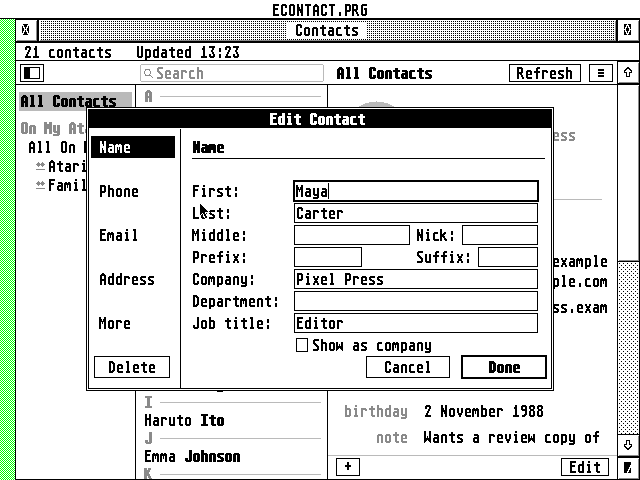
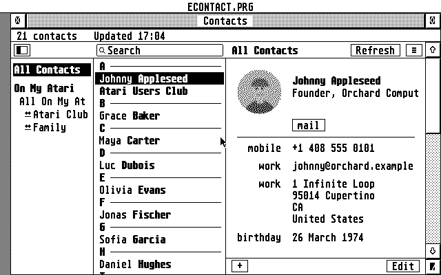
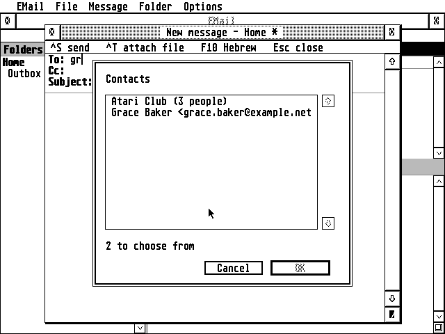
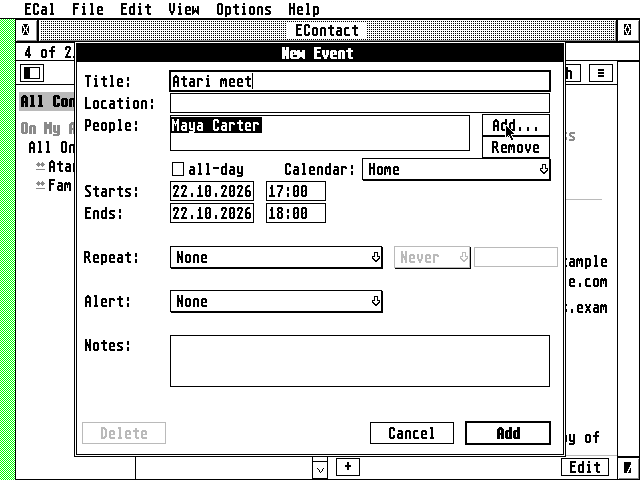

# EContact: how it works

What the README's front page leaves out: what EContact does, in detail.

## What it does

Like ECal, EContact runs as a **desk accessory**, so it opens from the Desk menu over whatever program
you're in, and it is laid out like the Mac's Contacts: the groups on the left, the people in the middle
under a search field, the chosen person's card on the right.

- **The list**, sorted by last name under letter headings, the first name plain and the last name
  bold, the chosen one in a blue bar, as on the Mac. **Settings** sorts by first name or shows
  "Last, First". **Several at once**: Shift+click, Control+click and ^A choose several, to delete
  them, put them in a group or take them out, write to them all, copy or export them in one go.
- **The card**: the contact's photo in a circle (or the initials in grey when there is none), the
  name, the job and company, then every phone, email, web page and address with its label in grey
  ("mobile", "iPhone", "home", "work", "home fax", or your own), the birthday and the note. Click a
  value to copy it, or to write to an address in EMail; the **mail** button does the same.
- **Photos**: the JPEG in the card (as the Mac and iPhone write it) or behind a link (as iCloud often
  gives it), cropped as you cropped it on the iPhone, dithered to the screen's own colours on a Falcon
  or TT and to black and white on an ST. Syncing leaves them on the server: a photo is fetched when
  its card is opened, or all of them at once with **Sync Contact Photos...** (a progress bar, the time
  left, Cancel, and it goes on where it stopped; not in the accessory with under 1.5 MB free at start, a
  1 MB ST for one, whose memory is kept for the contacts: `ECONTACT.PRG` can). Decoded once (a second or two on a Falcon, about
  four on an 8 MHz ST, as measured in Hatari) and kept in `CACHE\PHOTOS.PAK`; a photo changed on the
  iPhone is noticed and decoded again (see [Photos and their cache](#photos-and-their-cache)).
- **Search** as you type: names, companies, emails, phone numbers (with or without spaces and
  dashes), addresses and notes.
- **Editing**: **+** and **Edit** at the bottom of the card, as on the Mac. The card's parts are
  sections of one dialog (Name, Phone, Email, Address, More) so it fits an ST's screen; labels come
  from a pop-up or **Custom...**. What EContact doesn't edit (the photo itself, related names, social
  profiles, Apple's own fields) is kept as it was.
- **Groups**: All Contacts, each account, its groups. **New Group...**, **Add to Group...**, Remove
  from the group, rename, delete; **Send Email to Group** gives EMail everyone in it. iCloud's group
  cards and Nextcloud's categories both work. A contact you make while a group is shown goes into it.
- **iCloud** and any **CardDAV** server: address books found automatically, changes made elsewhere
  fetched with ETags so only what changed comes over the line, saves checked with If-Match so a change
  made on the iPhone meanwhile isn't overwritten.
- **On My Atari** address books, kept only on this computer.
- **vCard files**: import (3.0, 4.0 and the 2.1 of old phones, with quoted-printable and any charset;
  written to the server as 3.0) and export, of one card, a group, a book or the search results.
- **My Card**, as on the Mac; the window opens on it.
- **Fonts** (the system font or any fixed-width GDOS font, in the family's Font dialog), the window and everything else are
  remembered in `ECONTACT.INF`, which explains itself.
- **Smooth on an ST**: the window is drawn off the screen and shown at once; the list scrolls by
  moving what is shown, and the scroll bar's arrows and track go on while held. The scroll bar
  is drawn by the AES, so it takes its look: TOS's, the 3D one, or a theme under XaAES. Text fields hold
  more than they show (a long server address, a name) and scroll with the cursor.
- **At home under MiNT and MagiC**: there the dialogs are windows of their own, moved and closed as
  any window while other programs go on, and the alerts are the system's.
- **A crash** in the program is caught: it says so, writes `CRASH.LOG` and quits, leaving the
  Atari running (the guide, When something goes wrong).

 

## EMail and ECal

EContact is the address book of the other two:

- **EMail**: the addresses it shows carry EContact's names, and its **Address book...** (^B) picks
  people or a group in EContact's window (Choose or Cancel in the toolbar). EContact's **mail**
  button, or a double-click on an address, opens a new message to that person in EMail.
- **ECal**: an event has **People**; **Add...** picks people or a whole group from EContact (or takes
  an address). iCloud and other CalDAV servers that do scheduling (RFC 6638) send the invitations by
  email. An invitation from someone else shows who sent it. ECal's **Contacts...** in its menu
  opens EContact's window.

 

They ask EContact with the family's PEOPLE message (EMail 1.35 and ECal 2.8 or later; no program
reads another's files):
[docs/INTEGRATION.md](INTEGRATION.md) describes how the three talk, so other programs can use
EContact too.

## Photos and their cache

Photos are most of an address book: 500 contacts with photos are about 12 MB of vCards, half a
megabyte without them. So:

- **Syncing leaves the photos on the server.** Cards are asked for with CardDAV's partial retrieval
  (RFC 6352 8.4): only the properties EContact shows, and `PHOTO` without its value, which says there
  is a photo but not what. The card is kept as fetched in part. A server that ignores the request
  (Radicale does) sends whole cards, and their photos are kept as they come; one that refuses it gets
  the plain request.
- **A photo is fetched when its card is opened**: the whole card, in one request. **Sync Contact
  Photos...** in the menu does it for everyone, a few cards a request, with a progress box (who, how
  many, the time left, Cancel). Stopped half way, it goes on from there the next time.
- **Before a card fetched in part is changed** (edited, put in a group) it is fetched whole, and the
  change is made to that, so nothing the server has (the photo, related names, social profiles) is
  lost.
- **Answers are asked for in sizes that fit in memory**: as many cards at a time as fit in the
  memory set aside for a sync (24 KB on a 1 MB ST, 64 KB on a Falcon; the last answer tells how big
  they are), halved when one is too big anyway; a card too big even alone comes without its photo.
- **Few disk accesses** (the family's guidelines, 6.5): a sync gathers what it brings in memory and
  writes each file once at its end (or when that memory is full), the accessory touches no file while
  it waits, `ECONTACT.INF` is read once at start-up, and files are read 16 KB at a time on an ST, 32
  KB on a Falcon. Measured in Hatari on a Falcon with 200 contacts, 1.49 against 1.50: Sync Contact
  Photos for 24 photos opened files 127 times, now 18; a refresh with 10 changed cards 52, now 5;
  start-up 19, now 14 (33 and 17 on a 1 MB ST).
- **The cache keeps photos apart**: `CACHE\BOOKnnnn.DAT` has the cards with a stand-in for each photo
  (`X-ECONTACT-PHOTO:` and the photo's fingerprint), `BOOKnnnn.PHO` the photos. Start-up reads only
  the cards: in Hatari, 500 contacts with photos open in 5 seconds on a Falcon (it was 3½ minutes with
  the photos in the cards) and 32 on an 8 MHz ST. EContact 1.9's cache is converted once, the first
  time it is read (72 seconds for those 500 on a Falcon). The stand-in never leaves the Atari.

A photo is decoded with ChaN's TJpgDec ([third_party/tjpgd](../third_party/tjpgd)) at 1/2, 1/4 or 1/8
of its size (1/8 needs no IDCT, which is what makes it quick on a 68000), cropped to a square and
averaged into a 64x64 colour picture. The JPEGs TJpgDec won't take (progressive ones, the "extended"
SOF1, 4:4:0 sampling, unusual table layouts, CMYK) are read by `src/jpegdc.c` from each 8x8 block's
average alone: a progressive JPEG's first scan has them all, so the rest of the file isn't read. PNG
and HEIC aren't shown; the reason for each photo that isn't is in the status line, the closing alert
and the log. That picture (8 KB) is kept in one file for all of them, `CACHE\PHOTOS.PAK`, whose index
EContact holds in memory, and dithered for the screen when shown. (Up to 1.49 each had a file of its
own in `CACHE\PHOTOS`: that folder can be deleted, and Sync Contact Photos makes them again.)

Keeping it right:

- every cached picture records a fingerprint of the card's whole `PHOTO` line (shifts and
  exclusive-ors: a 68000 multiplies in software). When the photo is changed anywhere (the iPhone, the
  Mac, icloud.com), the line changes, the fingerprint no longer matches, and the picture is made again
  the next time the card is shown. A card that was fetched whole and has changed is fetched whole
  again when syncing, so its new photo is seen;
- a photo given as a link can change while the link stays the same. So the cache also records the
  card's ETag and the picture's: when the card has changed, the picture is asked for again with
  `If-None-Match`, and a "304 Not Modified" keeps the cached one, a new picture replaces it;
- a photo taken off a card takes its picture with it, and after each refresh the pictures of contacts
  that are gone are removed.

Pictures are read a quarter of a second after you choose a contact, so the arrow keys go down the list
without waiting; the initials show until the photo is there. Offline, a cached photo still shows.
**Settings > General > Show contacts' photos** turns them off. The account's password is sent only to
the account's own server (or iCloud's photo servers), never to a link elsewhere.

## How many contacts

Measured in Hatari on an 8 MHz Mega ST under EmuTOS, with the ST edition of then (`ECONTST.ACC`; since
1.64 `ECONTACT.ACC` runs on an ST, some 4 KB bigger) and cards like iCloud's (a
name, a company, one or two emails, two phones, some with an address, birthday or note):

| ST | EContact's memory | Contacts | Start-up |
|----|-------------------|----------|----------|
| 1 MB | 250 KB | about 490 | 10 s for 490 |
| 2 MB | 750 KB | about 1,500 | about 30 s |
| 4 MB | 1.8 MB | about 3,700 | 45 s for 2,500 |

(1 MB and the 4 MB start-up measured; the rest worked out from the size of a contact.)

- **About half a kilobyte a contact** in memory (photos stay on disk). The accessory takes the
  memory it measured it needed the last time (`MEMKB=` in `ECONTACT.INF`: its contacts at their
  busiest, a photo shown, room for a sync and a tenth more), leaving the rest to the programs you run:
  200 contacts take about 200 KB. The first start, before it has measured, takes half of the memory
  free, a quarter where 1 MB or more is free (at most 2 MB, 1.5 MB on a Falcon or TT, 4 MB of TT RAM),
  and more at the next start if its contacts need it. `HEAPKB=` sets an amount of your own.
- With more in the address book than fit, a few less show: each card in the cache keeps about 125
  bytes in memory either way (1,000 on a 1 MB ST: 300 shown).
- **Contacts that don't fit are never left out quietly**: the window says "N not shown" and an alert
  says that EContact takes more at the next start (or, when the Atari has no more, the most it can
  have). EMail and ECal then find names only for the contacts EContact holds.
  Once memory is full, the rest are counted, not read only to be let go: 1,500 contacts on a 1 MB ST
  start in 15 s, not 28.
- **The accessory reads its books in the background** a minute after boot (`START=`), in steps of
  at most 50 ms on a Falcon and 100 ms on an ST between the other programs' turns, so the first
  opening is at once. Measured in Hatari with 600 contacts and an AES_PROFILE build
  (`tests/hatari/quiet_start.py`): the whole read takes 4.4 s of an 8 MHz ST's time (1.1 s on a
  16 MHz Falcon), spread over 8 s; the longest stretch between event calls is 100 ms on the ST
  and under 50 ms on the Falcon. When the copy on disk is the one the index was made from, nothing is
  hashed (the cards are found by where they are).
- **Start-up reads parsed contacts** from `CACHE\BOOKnnnn.IDX`: a card is parsed (about 85 ms on an
  8 MHz ST) only the first time, and after it changes; the rest take about 18 ms each. A new version
  keeps the index unless its card parser changed; then the first start parses everything once (2,500
  contacts: 4 minutes on an ST; 600 take 13 s on a Falcon). With **Write a log** on, the log says
  how long each address book took to read.
- **Syncing a big address book** reads the server's list of cards as it arrives when memory is small,
  keeping only what needs fetching.
- STinG takes 100 KB or more of its own: with it, a 1 MB ST holds about 400 contacts. A 512 KB ST
  can't run EContact (`ECONTACT.ACC` alone is about 505 KB: 288 KB of program, 166 KB of buffers and
  its 48 KB stack; on an ST `TLS.OVL` stays on the disk).
- **With EMail on a 1 MB ST, use `ECONTACT.PRG`, not the accessory.** The accessory and its memory
  take about 650 KB of the 1 MB for as long as the Atari runs, which leaves too little for EMail to
  start beside it. With the accessory, EMail needs 2 MB.
- **On a 1 MB ST, `ECONTACT.ACC` or ECal's accessory, not both:** together (some 920 KB as they
  load) they leave TOS no memory and the ST stops at boot. Run the other as a program.
