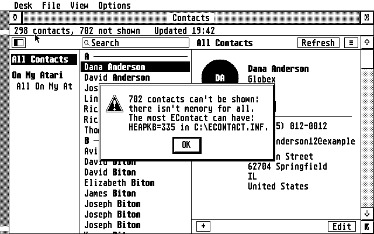
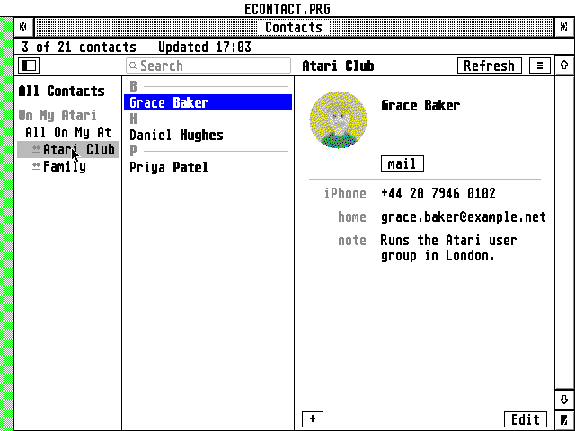
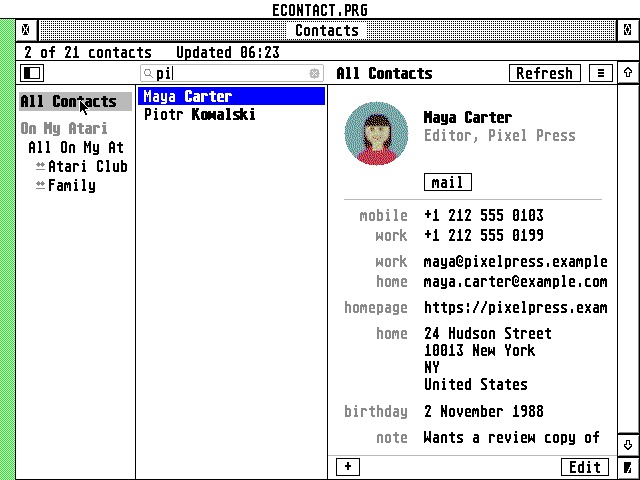
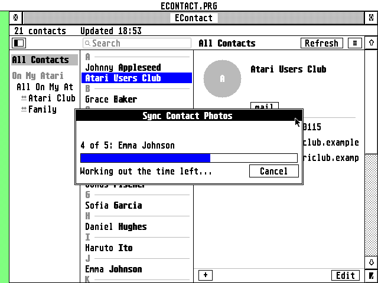
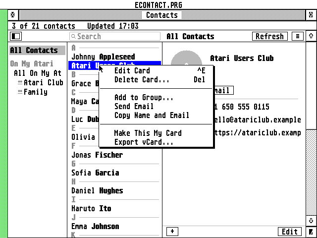

# EContact - user guide

Contacts for the Atari ST, TT and Falcon, like the Mac's Contacts:
iCloud and other CardDAV address books, or contacts kept on the Atari
alone, with EMail and ECal finding the people in it.

## Installing

EContact is a desk accessory: TOS loads it at boot from the root of the
boot drive, and it waits in the Desk menu as **EContact** until you
choose it.

**A quiet start.** At boot the accessory only takes its memory. A minute
later it reads your address books, a little at a time between the other
programs' turns (never more than 50 ms in one go on a Falcon, 100 ms on
an ST), and waits while you move the mouse or type, or while
`ECONTACT.PRG` runs. So the first opening is at once. `START=` in
`ECONTACT.INF` says when it begins: a number of seconds after the Atari
starts (60), `now`, or `opened` (not until you first open it). Opened
before it is done, it reads the rest at once.

| Your Atari        | Copy to `C:\`    | Connects                        |
|-------------------|------------------|---------------------------------|
| Falcon, TT        | `ECONTACT.ACC`   | by itself (Falcon mode) or through the Pi |
| ST, STE, Mega ST  | `ECONTST.ACC`    | through the Raspberry Pi gateway |

The settings are in `ECONTACT.INF` in the root of the boot drive, where
the accessory, EMail and ECal can always find them. Everything else is in
EContact's folder, which can be anywhere: `FOLDER=` in `ECONTACT.INF`
says where.

```
C:\ECONTACT.ACC
C:\ECONTACT.INF           settings, accounts, address books; FOLDER= names the folder
C:\ECONTACT\              EContact's folder (or another one):
    ECONTACT.PRG          the program, if you use it
    ECONTACT.KEY          the key the passwords in ECONTACT.INF are encrypted with
    CACHE\                a copy of every address book (BOOKnnnn.DAT)
    ECONTACT.FNT          which GDOS fonts are fixed-width (made by Font...)
    CACERT.PEM            Falcon mode: root certificates (copy them here)
    ROOTS.DAT             Falcon mode: the same, decoded ahead of time
    ECONTACT.LOG          with Write a log on
    CRASH.LOG             what happened, if ECONTACT.PRG ever crashes
    ECONTACT.HYP          this guide, for EHypView or ST-Guide: the Help key opens it
    ECONTACT.REF          its pages' names, for ST-Guide's index
```

- **`ECONTACT.PRG`** is the same program, to start from the desktop or a
  shell; it ends when its window closes. It has a menu bar (**File**,
  **Edit**, **View**, **Options**, **Help**) with the commands of the
  accessory's menu. It uses the folder it was started from as EContact's
  folder and writes that into `FOLDER=`, so starting it once from your
  folder is all it takes for the accessory to find it too.
- **Both installed:** they share the settings and the folder, and never
  work on them at once. While `ECONTACT.PRG` runs, EContact in the Desk
  menu brings the program's window to the front instead of opening the
  accessory's; when the program has changed the files, the accessory
  reads them all again as it next opens. Under MagiC or MiNT, where the
  accessory runs beside the programs, starting `ECONTACT.PRG` opens the
  accessory instead.
- **The accessory** reads `FOLDER=` when it starts. If it's empty, or
  the folder isn't there any more, the first time you open Contacts it
  asks where the folder is: **Locate...** opens the file selector (pick
  any file in the folder), or use `C:\ECONTACT`. The answer is kept in
  `FOLDER=`.
- Settings kept in the folder instead (`C:\ECONTACT\ECONTACT.INF`, or
  `ECONTACT.INF` next to the program) are copied to the root the first
  time, when there are none there.

**Memory.** The accessory takes its memory once, at boot: 1.5 MB on a
Falcon or TT (4 MB from TT/Fast RAM where there is some), half of what's
free on an ST: about 250 KB on a 1 MB ST (some 490 contacts), 750 KB on
2 MB (1,500), 1.8 MB on 4 MB (3,700). `HEAPKB=` in ECONTACT.INF sets
another amount, in kilobytes (`ECONTACT.PRG` takes what it needs from
all that is free); a contact takes about half a kilobyte, and
a sync wants a fifth of the memory free besides. If contacts don't fit,
the window says how many aren't shown and an alert says what to set.



**TT RAM.** On a TT, or a Falcon with an accelerator's Fast RAM, TOS
loads EContact into TT RAM, and its memory comes from there too, leaving
ST RAM to the programs that need it. The accessory then takes 4 MB (still
at most half of what's free). The About box says "TT RAM" when EContact
runs there, and with **Write a log** on, the log's first line says where
the program and its memory are.

## Accounts

File > **Add account...** (in the accessory, the menu: the button at the
top right):

- **iCloud**: your Apple ID and an **app-specific password** (make one at
  appleid.apple.com > Sign-In and Security > App-Specific Passwords; your
  own password doesn't work for other programs). EContact finds your
  address book at contacts.icloud.com.
- **Other CardDAV account**: the server's address (for instance
  `https://carddav.fastmail.com/`, `https://cloud.example.org/remote.php/dav`,
  or the address of one address book), user name and password. Google
  wants OAuth, which EContact can't do: export your contacts as a .vcf
  file at contacts.google.com and import it into an On My Atari book.
- **On My Atari**: an address book kept only on this computer.

Servers want a secure connection: in **Settings > Connection** either
type the address of the Raspberry Pi gateway or, on a Falcon or TT, turn
on **Falcon mode**.

The gateway is the `dav` service of the AERA gateways. On the Pi, in a
clone of EContact, ECal or AERA-Gateway, `sudo gateway/aera-gateway
install dav` sets it up, on port 8180. One Pi serves ECal and EContact
alike: if ECal already works through it, type the same address and port
here. `gateway/README.md` tells the rest.

Right-click an account's name on the left to refresh it, change its
settings or delete it from this Atari (nothing is deleted on the server).

## The window


- **On the left**: All Contacts, then each account with its address books
  ("All iCloud") and their groups. Click one to see those people. The
  button at the top left (or Shift+^S) hides the list.
- **In the middle**: the people, sorted by last name under letter
  headings. Click one to see their card; the arrow keys move up and down,
  Clr/Home goes to the first (Shift: the last).
- **Search**: just type. The list keeps those whose name, company, email,
  phone number, address or note has what you typed ("0170 123" finds
  "0170 1234567"); Backspace takes a letter back, Esc ends the search.
- **On the right**: the card. Click a phone, address, birthday or note
  to copy it to the clipboard; click an email to copy it or write to it
  in EMail (a double-click writes at once). **mail** under the name writes
  to the person (asking which address when there are several).
- **At the bottom of the card**: **+** for a new contact and **Edit**.
- The info line says how many contacts are shown and when they were last
  updated.

Where the AES can iconify windows (MultiTOS, MagiC, XaAES, N.AES), the
window has the iconify button: EContact shrinks to its icon, with the
number of contacts under it.

 

## Photos

A contact's photo shows in the circle at the top of the card, as on the
Mac, cropped the way it was cropped on the iPhone. Photos are in the cards
themselves, or a link to iCloud's photo server, which EContact fetches
with your account.

Syncing doesn't download them: they are most of an address book (500
contacts with photos are about 12 MB), and an ST's memory and a gateway's
link are small. The first time a card with a photo is shown, the photo is
fetched and decoded (the busy bee and "Getting the photo..."; a second or
two on a Falcon, about four seconds on an 8 MHz ST, and the time to
download it) and kept in `CACHE\PHOTOS`; after that it shows at once,
offline too.

To have them all, choose **Sync Contact Photos...** in the menu (the
button at the right of the toolbar). A box shows who is being done, how
many are left and about how long it will take. **Cancel** (or Esc) stops
at once, even in the middle of a photo; what is done is kept, and choosing
it again goes on from there. Offline, it makes the pictures of the photos already
downloaded. Some servers send the photos while syncing anyway: those are
kept as they come, and Sync Contact Photos only has to decode them.



When someone's photo changes on another device, EContact sees it after the
next refresh and decodes the new one; a photo taken off a card goes, and
so do the pictures of deleted contacts.

On a Falcon or TT in 16 or 256 colours the photo is dithered to the
screen's colours; on an ST it is black and white. Settings > General >
**Show contacts' photos** turns them off (the initials show instead).
EContact shows JPEG photos of every kind (baseline and progressive,
CMYK too), which is what iPhones, Macs and most other places write. A
photo it can't show (a PNG, an iPhone's HEIC, a damaged one) keeps the
initials, and the status line says why when the card is opened. At the
end of Sync Contact Photos an alert says how many weren't made and the
main reasons; with **Write a log** on, ECONTACT.LOG has a line for each
one (its name and why) and a summary.

## Changing a card

**Edit** (or a double-click, Return, ^E) opens the card's sections:

- **Name**: first, last, middle, nickname, prefix ("Dr."), suffix,
  company, department, job title; **Show as company** makes the company
  the card's name, as on the Mac.
- **Phone**, **Email**: six of each, each with its label: mobile, iPhone,
  home, work, main, home fax, work fax, pager, other, or **Custom...** for
  your own word.
- **Address**: two addresses (a third one from the Mac is kept as it is).
- **More**: the birthday as day.month.year ("17.05.1975", or "17.05"
  without the year), web pages, and the note.

**Done** saves to the server at once; **Delete** deletes the card (on the
server too). What EContact doesn't edit (the photo, related names,
social profiles, instant messaging, the iPhone's own fields) stays on the
card as it was. If the card was changed on another device in the
meantime, the server refuses the save: refresh (^R) and edit again.

Text fields take Hebrew: F10 switches to the Israeli keyboard, and a
Hebrew name or note is shown right to left.

## Groups



- **New group**: the menu > New group (^G), or right-click an address book.
- **Add to Group...**: right-click a contact; the list ticks the groups it
  is in, and choosing a ticked one takes it out. A new contact made while
  a group is shown goes into that group.
- **Remove from (group)**: right-click a contact while the group is shown.
- Right-click a group to **Send Email to Group** (everyone in it, in
  EMail's To: line), export it, rename it (or double-click it) or delete
  it (the people stay).

iCloud keeps a group as a card of its own listing its members; Nextcloud
and some others put the group's name in each member's categories. Both
show and work the same way here; new groups are made as group cards.

## Import and export

- **Import vCards...** (the menu, or right-click an address book): a .vcf
  file with one or many cards, from a phone, Outlook, Google or another
  Mac. Old 2.1 cards are written as 3.0, which iCloud wants.
- **Export vCards...**: the chosen card, or all the list shows (an
  address book, a group, or what a search found). Cards whose photos
  weren't downloaded yet are fetched whole for it; offline they are
  exported as they are kept, without their photos.
- **From other programs**: .vcf files handed to EContact by a desktop
  such as Thing, jinnee or Gemini (or any program, with the AV
  protocol's VA_START) are imported into the address book new contacts
  go into. `ECONTACT.PRG` takes them the same way when the desktop starts
  it with one (installed as the application for `.VCF`).

## My Card

Right-click your own card > **Make This My Card**. The list marks it
"me", and the window opens on it.

## Settings

- **General**: sort by last or first name, show names as "First Last" or
  "Last, First", which address book new contacts go into, where the font
  has its Hebrew letters, starting with the Hebrew keyboard, and showing
  photos.
- **Refresh**: refresh all every 15 minutes, hour or day, or only by
  hand (^R, the Refresh button); when the window opens, unless that is
  turned off; and, for the accessory, **Once at start**: 2, 5 or 15
  minutes after the Atari started. The accessory refreshes with its window closed too, in
  the background: one exchange with the server at a time, only the
  contacts that changed fetched and added to the copy on disk, and
  nothing at all while you move the mouse or type. An address book whose
  copy has to be written anew, and a new account's books, wait for a
  refresh with the window open. Opening the window stops a refresh in
  the background; what it had fetched is kept.
- **Connection**: Falcon mode and the DSP, the Pi gateway, and the log.

Settings opens with Options > **Settings...** (^,), or from the menu in
the accessory. The Options menu also has **Work offline** (no
connections at all: everything shown comes from the copy on disk; a
server's address book can't be changed until you're online again) and
**Font...**; Help has **Keys...**, and the EContact menu **About**.

## With EMail and ECal

**mail** in EContact opens a new message in EMail, to the person or the
group, when EMail is running; when it isn't, the address goes to the
clipboard, and ^V puts it on EMail's To: line. ^C copies the contact
you chose the same way, "Maya Carter <maya@example.com>", ready for a
To: line.

Under MultiTOS, MagiC or XaAES you can drag .vcf files onto EContact's
window to import them. Running as an accessory, EContact tells the
desktop about its window, so Thing and the like can drop .vcf files on
it there too.

EMail and ECal ask EContact for people (the PEOPLE message): the names
behind the addresses they show, and people chosen in EContact's window.
EContact answers from the contacts it holds, so the accessory must be
installed (or ECONTACT.PRG running); without it they show the addresses.
When EMail or ECal asks you to choose, EContact's window opens with
**Cancel** and **Choose** in place of Refresh and the menu: click people
to tick them (a double click chooses at once), or choose a group on the
left, then **Choose** (Return); **Cancel** (Esc), closing the window or
quitting chooses no one. In EMail 1.35 and ECal's next releases:

- **EMail**: the addresses it shows carry EContact's names, and its
  address book picks people or a group in EContact's window.
- **ECal**: an event's **Invitees** line takes addresses; **Add...** picks
  people or a group in EContact's window, searching for a name begun on
  the line.
  The invitations are written as the event's attendees, with you (the
  account's Apple ID or email user name) as organizer, and iCloud sends
  them. An invitation you received shows who it is from.
- **Contacts...** in EMail's File menu and ECal's menu opens EContact's
  window.

See [INTEGRATION.md](INTEGRATION.md) for how the programs talk.

## ECONTACT.INF

The settings file explains itself, like ECal's and EMail's: a note
before each setting, `1` for on and `0` for off. It can be edited with
any text editor while EContact isn't running (keys in any case, a note
after a value with ` ;`). A password typed in there in plain text is
encrypted with ECONTACT.KEY the next time EContact starts. EContact
writes the file anew as `ECONTACT.IN$` and only then puts it in the old
one's place, so a reset or a full disk while it writes leaves the old
settings as they were.
When ECONTACT.KEY can't be written (a locked disk, a full one, a folder in its
place), the passwords go into ECONTACT.INF as they are, and EContact says so once
each time it starts; once ECONTACT.KEY can be written, they are encrypted the
next time EContact saves its settings.

## Keys

| Key | Does |
|-----|------|
| ↑ ↓ | the contact above, below |
| Clr/Home, Shift+Clr/Home | the first, the last |
| Return, ^E | edit the card |
| Delete | delete the card |
| ^N | a new contact |
| ^G | a new group |
| typing | search |
| Esc, ^F | a new search |
| ^C | copy the contact chosen: "Name <email>" |
| ^V, ^X | paste into the search, cut it |
| ^C ^X ^V | in a dialog: copy, cut, paste a field |
| ^R, Shift+^R | refresh, everything again |
| Shift+^S | the groups on the left |
| ^, | Settings |
| F10 | Hebrew keyboard |
| ^W, ^Q | close the window (^Q also quits the program) |
| Help | this guide in EHypView, ST-Guide or HypView (without one: how to get one, or the keys) |
| Double-click | edit; on an email: write to it |
| Right-click | more choices |

While the busy bee shows (a refresh, saving a card to the server), Esc or
Undo stops what EContact is waiting for from the server, at once rather
than after the minute it would wait: the alert then says "stopped".
Anything else you type meanwhile is kept for afterwards.

## When something goes wrong

- `ECONTACT.LOG` (Settings > Connection: the log) has the conversation
  with the servers.
- **A crash**: if EContact itself goes wrong (what would be 2 to 8 bombs),
  it says so, writes what happened to `CRASH.LOG` next to `ECONTACT.PRG` and
  quits, leaving the Atari running. A crash in the system or a driver
  still gives the bombs; TOS keeps a record of them, and EContact adds it to
  `CRASH.LOG` the next time it starts (and says so if the crash was in
  EContact). Send `CRASH.LOG`, with `ECONTACT.LOG` if the log was on, to the author. Under MiNT or MagiC, which
  handle crashes themselves, there is no `CRASH.LOG`, nor in the accessory.
